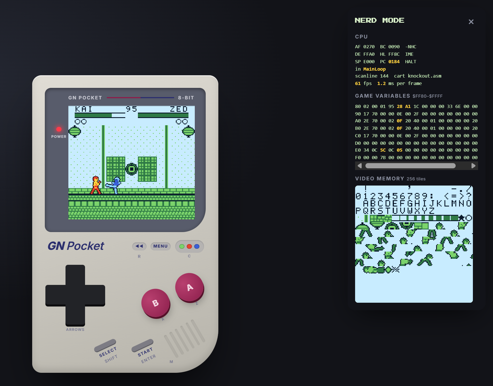
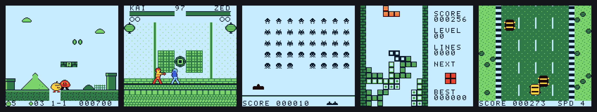
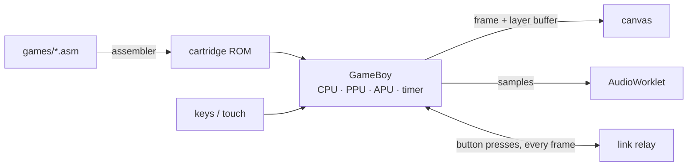

# GN Pocket

**A Game Boy built from scratch: the console, the assembler that makes its cartridges, and every game on it.**

[**▶ Play it in your browser**](https://http-gareth.github.io/gn-pocket/) · works on a phone, and can be added to the home screen as a full-screen app



No emulator libraries, no borrowed ROMs, no dependencies. About 3,000 lines of TypeScript run a cycle-accurate Sharp SM83 CPU, the picture and sound chips, and a two-player link cable. About 13,000 lines of hand-written Game Boy assembly make up the ten games.



## What's inside

| | | |
|---|---|---|
| **Hardware** | The SM83 CPU (every instruction, timed per memory access), memory map and interrupts, timer, joypad, the scanline picture processor, and all four sound channels | [`src/hardware`](src/hardware) |
| **Toolchain** | An assembler with includes, local labels, expressions and pixel-art rows (`` dw `00333300 ``). It runs in the browser, so every cartridge is built live when you insert it | [`src/assembler`](src/assembler) |
| **Games** | Ten original cartridges, a menu cartridge that scrolls the library, and a shared library for text, sound effects and music | [`games`](games) |
| **Link cable** | Lockstep netplay: both consoles run the same game and swap button presses every frame, through a WebSocket relay written on Node's standard library | [`src/netplay`](src/netplay), [`server`](server) |
| **The console** | The handheld itself: touch D-pad with diagonals, rumble, colour palettes, rewind, save states and Nerd Mode | [`web/console`](web/console) |
| **Make your own** | A Game Studio (write assembly, press RUN, play it) and a Pip Quest level editor that paints with the cartridge's real tiles | [`web/tools`](web/tools) |

## The games

| Game | |
|---|---|
| **Pip Quest** | A side-scrolling platformer with an original hero. Two overworld courses, then Krag's castle: lava pits and a boss you stomp three times. Checkpoints and five lives. |
| **Knockout** | A one-on-one fighter, best of three, against the CPU or a friend over the link cable. Punches, kicks, jump kicks, blocking and a fireball. |
| **Invasion** | The formation glides and speeds up as it thins. A mystery ship crosses for bonus points, and every third wave is a mothership boss. |
| **Blocks** | The falling-blocks puzzle, with wall kicks, a next-piece preview, rows that flash before they clear, and music on the wave channel. |
| **Racer** | A top-down highway. Faster scores more, and the traffic gets thicker. |
| **Bricks** | Where the ball hits the paddle sets its angle. Clear the wall and the next one is faster. |
| **Flap** | Flap through an endless, randomly built pipe course. |
| **Shootout** | Five penalties each: shoot, then dive to save. |
| **Snake** | Eat, grow, speed up. |
| **Pong** | Two players over the link cable, or you against the CPU. The rally speeds up and angles vary, so no rally loops forever. |

## How it works



- **One frame.** The CPU steps instruction by instruction, and the timer, picture and sound chips are advanced by exactly the cycles each instruction took. A frame ends at vertical blank, about 70,224 cycles, so the screen never tears.
- **Colour.** As it draws, the picture processor tags each pixel with the layer it came from: background, or one of the two sprite palettes. That lets the console colour an original-style game the way a Game Boy Color does.
- **Rewind and saves.** The whole machine (CPU, memory, timer, picture state) snapshots into reused buffers. Every fourth frame goes into a 300-deep ring, which gives 20 seconds of rewind with no garbage-collection pauses.
- **Link cable.** Each console sends its buttons for the frame four frames ahead, and only runs a frame once it holds both players' buttons for it. Both machines stay identical, frame for frame. Every 120 frames they compare a checksum of memory to catch any drift.
- **Sound.** An AudioWorklet plays from a jitter buffer that gently speeds up or slows down to stay in step with the emulator. Where AudioWorklet isn't available (pages over plain `http`), a fallback plays from the same buffer.
- **Nerd Mode.** Live registers, the routine the CPU is in (looked up from the assembler's labels), game variables lighting up as they change, and all 256 tiles in video memory.

## Project structure

```
gn-pocket/
├── src/
│   ├── hardware/      cpu · memory · ppu · apu · timer · gameboy
│   ├── assembler/     assembler · library (menu list) · level (editor format)
│   └── netplay/       lockstep · protocol (message validation)
├── games/             ten cartridges + menu.asm, lib/ (font, sound, music), examples/
├── web/
│   ├── console/       main · screen · speaker · touch · nerd · saves · audio-worklet
│   ├── tools/         studio · editor
│   ├── css/
│   └── index.html · studio.html · editor.html
├── server/            index · files (static, security headers) · relay (link cable)
├── scripts/build.ts   static build for GitHub Pages
├── test/              71 tests
└── docs/              README images
```

## Run it

```bash
npm start       # http://localhost:5190, plus the link-cable server
npm test        # 71 tests
npm run build   # static copy in dist/, deployed to GitHub Pages on every push
```

Node 22.13 or newer. There's nothing to install: Node strips the TypeScript itself.

`npm start` also prints a Wi-Fi address. Open it on two phones to play each other: one taps **MENU → HOST A GAME**, the other types in the 4-letter code. The hosted copy plays every game, but two-player needs the link server, so it runs from `npm start`.

## Controls

| | Keyboard | Touch |
|---|---|---|
| Move | Arrow keys | D-pad (slide for diagonals) |
| A / B | Z / X | A / B |
| Start / Select | Enter / Shift | Start / Select |
| Back to the menu | Start + Select | Start + Select |
| Rewind | Hold R | Hold ◀◀ |
| Colours | C | The three dots |
| Save / Load | S / L | MENU |
| Nerd Mode | N | MENU |
| Sound on / off | M | Speaker grille |

## Tests

`npm test` runs 71 tests:
- CPU flags and instruction timing, interrupts, the timer, every assembler addressing form, all four sound channels, and rewind replaying history exactly.
- Headless players inside the real games: a bot crosses Pip Quest's first two worlds on foot, three stomps beat Krag, a driver reads the Racer traffic and survives, a player clears Invasion's first wave.
- Two consoles linked over a simulated laggy, jittery network that must stay identical on every frame.
- The server and relay under attack: path traversal, malformed URLs, cross-site connections and forged link messages.

## Security

The server, relay and pages are hardened: allowlisted files only, strict Content Security Policy, every link-cable message validated, rate limits, no `innerHTML` or `eval`, zero dependencies and pinned CI actions. See [SECURITY.md](SECURITY.md) for the full list and how to report a problem.

---

GN Pocket is an independent fan project. It isn't affiliated with or endorsed by Nintendo, and it contains no Nintendo code, BIOS or ROMs.
